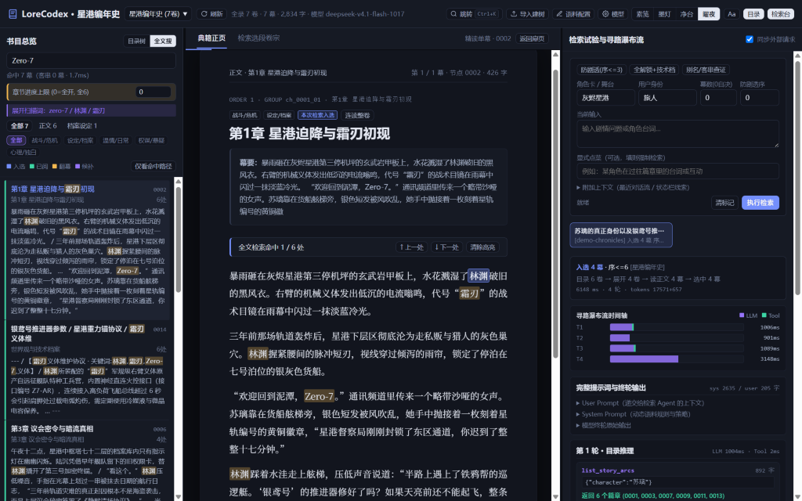

# LoreCodex (`st-tree-lore`)

[](https://github.com/lena13144/lorecodex/actions/workflows/ci.yml)


**让角色在扮演中翻阅原作：把整部小说或游戏剧情建成目录树，每轮对话前由检索模型查到原文场景，再交给正文模型。**

> 思路来自 [PageIndex](https://github.com/VectifyAI/PageIndex)：不把文档切成向量碎片，而是先用 LLM 建一棵带摘要的目录树，再让推理模型沿着目录往下翻。LoreCodex 把这个思路用在长篇叙事和角色扮演上，并从零实现为 SillyTavern / TauriTavern 扩展。

[English Documentation](./README.en.md)

---

## 它解决什么问题

同人卡和长线扮演里，最难的是让角色记住**原作里发生过什么、谁说过什么**：

- **世界书**存的是人写好的设定。几百条条目写起来费时，靠关键词触发，而原作的剧情经过和原话很难都写进去。
- **向量检索**擅长找意思相近的段落，但长篇叙事里常见的几类问题它答不好：
  - "她第三章那句原话是什么"这类要精确出处的问题；
  - 角色用外号、代号出现，名字和正文对不上；
  - 跨卷的前因后果；
  - 正在推进主线时，不该看到的后续章节。
- **只塞大纲**又会丢掉原作的对白腔调和细节。

LoreCodex 的做法是：

1. **建一次目录。** 把原作切成 `卷 → 篇 → 幕` 三级，由 LLM 为每一幕写摘要、为每一卷写总览，并整理出人物别名表和专有名词表。
2. **每轮对话前，检索模型自己翻。** 它用工具查卷目录、展开篇章、按人名和别名全文搜索，最后读原文场景。最终交给正文模型的场景**必须是它真正读过原文的**，不是凭摘要猜的。
3. **把完整原文场景注入正文模型。** 不截断、不切碎，正文模型能直接参考原作的语气和细节。

## 和其他做法的区别

| | 世界书 | 向量检索 | LoreCodex |
|---|---|---|---|
| 内容来源 | 人工写的条目 | 原文切片 | 原作全文，按卷、篇、幕组织 |
| 什么时候生效 | 关键词出现时触发 | 语义相近时召回 | 检索模型根据对话判断要不要查、查什么 |
| 注入内容 | 条目文本 | 几百字的片段 | 完整场景原文 |
| 外号、代号 | 要手写触发词 | 经常认不出 | 别名表自动展开 |
| 防剧透 | 无 | 无 | 按章节进度锁定可见范围 |

**代价也要说清楚：** 每轮检索都要调用一次检索模型，需要查原文时会跑多轮工具调用，会增加延迟和花费。纯闲聊时检索模型会判断跳过，但这一次判断本身也要调用。建目录需要一次性的 LLM 费用。它适合**有大量原作文本、在意原作忠实度**的场景；如果你玩的是原创卡或设定很少的卡，世界书就够了。

## 主要功能

1. **纯前端，免后台。** 插件内置 IndexedDB 引擎（`browser_engine.js`）和书阁工作台（`extension/st-tree-lore/ui/`）。在酒馆里通过 GitHub URL 安装后，不需要启动 Node.js、Python 或 Termux，手机 TauriTavern 和桌面浏览器都能直接建库、检索、查看检索过程。
2. **多种来源合成一棵树。** 支持 `.txt`（自动识别 UTF-8 / GB18030）、`.epub`、`.md`、SillyTavern 世界书 `.json`、带 `character_book` 的 V2 角色卡 `.json`，以及单文件书库包 `.lorepack.json`。
3. **LLM 建目录，可断点续传。** 按卷并发生成分幕摘要和卷总览，把代词还原成人名，自动整理人物别名表（`aliases`）和词汇表（`glossary`）。进度实时写入 IndexedDB，暂停后可以接着建。
4. **别名全文搜索。** 搜任一称呼会自动展开同一人物的所有别名，数百万字通常在 15 毫秒内完成；正文中出场但目录没署名的场景会标记为 `[CAMEO]`。
5. **防剧透进度锁（`maxOrder`）。** 设置后，目录、搜索和读取都不会返回之后的章节；不属于任何章节的通用设定不受影响。
6. **本局记忆召回。** 如果你的数据库类插件在消息里附带了 `# 记忆召回` 块（`编号(摘要)` 格式），检索模型会用它来理解当前对话里的指代，但不会拿它去原作里搜本局才发生的事。
7. **可分享的书库包。** 建好的目录可以导出为 `.lorepack.json`，别人导入即可使用，不必再付一次建目录的费用。

---

## 工作台界面预览

| 浅色主题 · **素笺 (`Paper`)**（导读卷宗与检索轨迹） | 深色主题 · **曜夜 (`Studio Dark`)**（别名搜索与原文高亮） |
| :---: | :---: |
|  |  |

---

## 检索过程

每次生成回复前（通过 ST 的 `generate_interceptor`，在用户消息写入之后、提示词组装之前），检索模型拿到你这一轮说的话、最近几轮对话，按层级往下翻：

```text
你的消息 + 最近 N 轮对话（+ 可选的本局记忆召回）
   │
   ▼  检索模型先判断：要不要查原作？纯闲聊直接跳过，不注入
   │
   ├──► 第 0 / 1 层：`list_series` 看卷总览，`list_story_arcs` 看篇章目录
   │       同时可以用 `grep_scenes` 按人名、别名全文搜索
   │
   ├──► 第 2 层：`get_arc_scenes` 展开候选篇章，看每一幕的摘要
   │
   └──► 第 3 层：`read_scene` 读原文（一次最多 10 幕）
           只有读过原文的场景才能被选中；全程遵守防剧透进度锁
   │
   ▼  注入正文模型：记忆导读 + 完整原文场景
```

这套工具和编程 agent（如 Claude Code）找代码的方式很像：看目录、搜关键词、读文件，读够了再动手。区别是这里每轮对话都可能触发，所以检索模型要先判断这一轮是否真的需要查。

---

## 安装与使用（SillyTavern / TauriTavern）

默认纯前端运行，桌面浏览器与手机 TauriTavern 均无需额外启动后台服务。

### 1. 安装扩展
1. 打开 SillyTavern 或 TauriTavern 顶部的 **扩展 (Extensions) → 安装扩展 (Install Extension)**；
2. 粘贴仓库地址并确认安装：
   ```text
   https://github.com/lena13144/lorecodex
   ```
3. 刷新页面，展开右侧面板里的 **LoreCodex 典籍检索**：
   - 默认内置《苍穹残响·灰烬星港编年史》示例书库，顶栏可切换深色（墨灯）与浅色（素笺）主题；
   - 侧边栏包含开关、书库选择与角色绑定、LLM 目录进度条、上次检索摘要和 **打开 LoreCodex 大面板** 入口（也可输入 `/loreui` 打开）。

### 2. 配置检索模型
1. 首次使用点击侧边栏的 **去配置** 提示，或在大面板右上角点击 **模型**；
2. 填入任意 OpenAI 兼容接口的 **API Base URL** 与 **API Key**（如 DeepSeek、Gemini OpenAI 兼容端点、OpenRouter、硅基流动等）；
3. 点击 **拉取模型** 并选择要用的模型（`Max Tokens` 留空即可沿用模型原生上限），保存。

### 3. 导入文本并建立目录
在大面板顶栏点击 **导入**（或通过 **书库管理** 查看、切换、导出和删除书库）：
1. 选择本地文件（`.txt` 自动识别 UTF-8 / GB18030、`.epub`、`.md`、世界书 `.json`、V2 角色卡 `.json` 或他人分享的 `.lorepack.json`）；
2. 点击 **开始导入**，先免费完成离线切分并查看**结构预检报告**（卷数、章数、字数和章节抽样），确认切分正常再消耗 API；
3. 确认无误后，点击 **开始 LLM 建立目录**（也可以在侧边栏进度条或大面板「LLM 建目录」启动）：
   - **断点续传**：进度实时同步在侧边栏和大面板，每完成若干章写入 IndexedDB，随时暂停，下次继续自动跳过已完成章节；
   - **按卷构建**：体量很大的作品可以在「书库设置 → LLM 目录补全」里指定某一卷逐卷构建；
   - **导出分享**：在「书库管理」里查看各书库的 LLM 覆盖率，导出为 `.lorepack.json` 分享给他人。

---

## GitHub Releases 分包

除了在酒馆里填 GitHub URL 安装，[**GitHub Releases**](https://github.com/lena13144/lorecodex/releases) 也提供了 **4 个独立的发行包**，按需下载即可：

| 发行包 | 适用场景 | 包含内容 |
| :--- | :--- | :--- |
| `lorecodex-sillytavern-tauritavern-extension-v2.2.0.zip` | SillyTavern / TauriTavern 玩家（免后台） | `st-tree-lore` 酒馆扩展、IndexedDB 前端引擎、内嵌工作台 UI、前端建库与 LLM 目录升级器、`demo-chronicles.lorepack.json` |
| `lorecodex-cloud-builder-kit-v2.2.0.zip` | 用云端 AI 建库（Gemini / Claude / Grok / Qoder / WorkBuddy 等） | 零依赖 Python 脚本（`build_novel.py`、`build_lore.py`、`pack_lorepack.py`）和 `AGENT_INSTRUCTIONS.md`，连同小说发给云端 AI 即可生成 `.lorepack.json`，无需另配 API Key |
| `lorecodex-agent-dsh-mcp-plugin-v2.2.0.zip` | AI Agent 集成（DeepSeek Harness `dsh` / Claude Code / Cursor / Antigravity） | DeepSeek Harness (`@deepseek-ai/cordis`) 插件、MCP stdio 服务端、Agent Skill 与核心树引擎（不含酒馆和 Web UI） |
| `lorecodex-full-server-workbench-v2.2.0.zip` | 独立运行桌面工作台 / 本地命令行建库 | 完整 Node HTTP 服务端（`127.0.0.1:5240`，也可绕过部分中转站的浏览器 CORS 限制）、独立 Web UI、Python 批量建树脚本、酒馆扩展与 Agent 插件 |

---

## 作为 AI Agent 工具使用（DeepSeek Harness / MCP / Skill）

仓库内置了 **DeepSeek Harness (`@deepseek-ai/dsh` / Cordis) 插件**（`src/dsh_plugin.js`）、**MCP Server**（`src/mcp_server.js`）和 **Agent Skill**（`skills/lorecodex/SKILL.md`）。

### DeepSeek Harness (`dsh`)
```bash
dsh plugin --profile web add "github:lena13144/lorecodex"
```
仓库自带 `cordis.patch.yml` 和 `dsh.bundle` 声明，加载后会自动注册全部 9 个工具。

### MCP Server（Claude Code / Antigravity / Cursor）
```json
{
  "mcpServers": {
    "lorecodex": {
      "command": "node",
      "args": ["/path/to/lorecodex/src/mcp_server.js"]
    }
  }
}
```

暴露的 9 个工具分为三类：
- **直接检索（6 个，不额外调用旁路模型）**：`lorecodex_list_corpora`（含 `LLM_TOC` 覆盖率）、`lorecodex_list_series`、`lorecodex_list_arcs`、`lorecodex_expand_arc`、`lorecodex_grep_scenes`（别名与 `[CAMEO]` 扫描）、`lorecodex_read_scenes`（单次最多读 10 幕原文）。
- **建库与写回索引（2 个）**：
  - `lorecodex_build_corpus`：从本地 `.txt` / `.md` / `.epub` / `.json` 建树，或按卷执行 `action: "upgrade"` 补全 LLM 目录摘要和别名表（默认 `use_llm: true`）；
  - `lorecodex_update_index_meta`：无需额外 API Key，让宿主 Agent 读完原文后直接把分幕摘要、卷总览、`aliases` 和 `glossary` 写回索引并热重载。
- **子 Agent 代理检索（1 个）**：`lorecodex_ask_agent`——由独立检索 Agent 翻完目录后只返回导读、大纲和选中的原文，减少主 Agent 的上下文占用。

---

## 酒馆插件功能与斜杠命令

- **角色卡绑定（`charBindings`）**：点击侧边栏的 **绑角色**，将当前书库、防剧透上限和视角绑定到当前角色卡，切换角色卡时自动切回对应配置。
- **防剧透与视角设置**：在大面板 **酒馆设置** 中按分卷/章节选择防剧透上限和当前视角（也可以点击侧边栏的 `防剧透≤N` / `视角` 徽章直接跳转）。
- **上次检索摘要与轨迹回放**：侧边栏单行显示最近一次命中的幕数与耗时，点击可展开命中列表并跳转到大面板查看完整检索过程。
- **斜杠命令**：
  - `/loreui` — 在酒馆内打开内嵌工作台
  - `/lorecodex [on|off]` — 开关检索
  - `/lorecorpus <corpus_id>` — 切换当前书库
  - `/loreorder <n|off>` — 设置或解除防剧透章节上限
  - `/lorepov <角色名>` — 设置当前视角（角色不在场的场景会标注为背景或转述）

---

## 可选：独立 Node 服务端与命令行建库

如果你需要脱离酒馆在浏览器里使用工作台（`http://127.0.0.1:5240`）、绕过部分中转站的浏览器 CORS 限制，或者把书库存在本地磁盘 `corpora/` 下供 MCP 和酒馆共享：

```bash
# 启动独立 HTTP 服务（局域网访问可加 --host 0.0.0.0）
node src/server.js

# 命令行离线切树（自带网页/MediaWiki 噪声清洗与预检；支持 --h1-is-volume / --strip-block / --allow-noisy）
python3 builders/build_novel.py --input path/to/novel.txt --corpus-id my-novel --name "我的小说" --no-llm
python3 builders/build_novel.py --upgrade --corpus-id my-novel --series "第1卷" --workers 8

# 将 SillyTavern 世界书或 V2 角色卡并入同一棵树
python3 builders/build_lore.py --input path/to/worldbook.json --corpus-id my-novel --merge-into corpora/my-novel --filter-game-stats
```

---

## 目录结构

```text
lorecodex/
├── manifest.json          # 仓库根清单（供 SillyTavern / TauriTavern 通过 GitHub URL 安装）
├── cordis.patch.yml       # DeepSeek Harness (dsh / @deepseek-ai/cordis) 插件声明
├── extension/
│   └── st-tree-lore/      # 酒馆纯前端扩展（默认免后台）
│       ├── index.js       # 侧边栏面板、generate_interceptor 注入、角色绑定与斜杠命令
│       ├── browser_engine.js # IndexedDB 前端引擎（解析、LLM 建库升级、别名搜索与 Tree Agent）
│       ├── style.css      # 抽屉与浮层样式
│       └── ui/            # 内嵌工作台（同步自根目录 ui/）
├── src/
│   ├── dsh_plugin.js      # DeepSeek Harness 插件入口（注册 9 个工具）
│   ├── mcp_server.js      # 零依赖 MCP stdio 服务端
│   ├── server.js          # 可选独立 HTTP 服务端与异步建库调度
│   ├── corpus_manager.js  # 多书库管理与懒加载
│   ├── tree_agent.js      # Node 端目录树检索与多轮工具循环
│   ├── prompt_builder.js  # 基于 corpus.json 的提示词与工具 Schema 生成
│   ├── grep_engine.js     # 内存别名与客串感知 grep
│   ├── graph_engine.js    # 可选一跳实体关系图谱查询
│   └── utils.js           # 跨平台 Python 探测、文本清洗与 order 门控
├── skills/
│   └── lorecodex/SKILL.md # AI Agent Skill 说明文件
├── ui/                    # 书阁与轨迹工作台前端源码
├── builders/              # Python 命令行建树与 --upgrade 升级脚本
├── corpora/
│   └── demo-chronicles/   # 内置示例书库（小说 + 世界书）
└── scripts/
    ├── build_releases.mjs # 打包 4 个独立 Release 发行包
    └── verify.mjs         # 端到端验收测试脚本
```

---

## 测试与打包

```bash
# 离线全量测试（无需 API Key，覆盖双端解析、Mock LLM 建库与断点续传、MCP、dsh 插件、防剧透门控与别名搜索）
npm test

# 构建 dist/releases/ 下的 4 个发行包
npm run build:releases
```

---

## 为什么不用向量库，连后台也省掉了

这个项目一开始并不是冲着“无向量、免后台”去的——恰恰相反，最开始做的就是一套标准的向量 RAG，弯路几乎一条没落：

1. **第一阶段：照着经典方案做向量 RAG**  
   最初面对几百万字的游戏解包剧情和长篇小说，顺理成章地上了固定字数切块、Embedding、向量索引和 Rerank。真放到角色扮演里一跑，问题马上就出来了：
   - 原本解包出来有头有尾的剧本，被硬切成了几百字一块的碎片，对白和反转经常拦腰断掉；
   - 角色换个外号或代号、在没署名的章节里客串说句话，或者聊到跨卷的前因后果，向量相似度很容易张冠李戴；
   - 更头疼的是，为了存几百兆向量和跑重排，每个想用的人都得先在电脑上挂一个后台服务。
2. **第二阶段：加上目录树，留着向量当兜底**  
   受 PageIndex 启发，改用 LLM 给整部作品建三级目录树和别名表，再配上内存里的别名搜索，但心里还是不太放心，把原来的向量检索留作兜底。结果跑了一阵子，回头翻检索日志一看，多少有点哭笑不得：**有了目录树和别名搜索之后，模型在 99.9% 的检索里压根没碰过那个向量工具。** 费了老大劲维护的一整套向量层，一直在那儿吃灰。
3. **第三阶段：砍掉向量，突然发现后台也不用留了**  
   把吃灰的向量层一刀砍掉之后，才突然反应过来：剩下的东西（目录树 `tree_index.json`、原文 `tree_texts.json`、别名搜索、多轮工具调用）全都是普通的 JSON 和字符串操作。既然这样，实在没道理继续让酒馆和手机玩家为了它去挂一个 `127.0.0.1:5240` 的后台进程。
   - 于是把建树（包括 GB18030 解码、`.epub` 解压、并发 LLM 建目录和断点续传）、搜索、检索 agent 和工作台一口气全搬进了浏览器，用 IndexedDB 存下来。
   - 顺手也拆掉了早期加在模型上的各种限制：不再写死 `max_tokens`，不再关掉思考，允许首轮并发调工具、一次连读多幕。与其把模型框死，不如给它一本好翻的目录和一把趁手的搜索工具，剩下的让它自己查。

## 灵感来源与致谢

- **[PageIndex (VectifyAI)](https://github.com/VectifyAI/PageIndex)**：LoreCodex 的核心思路来自 PageIndex，即不依赖向量切片，而是让推理模型翻阅分层目录树来定位内容。本项目从零独立实现，并针对长篇小说、游戏剧情和角色扮演做了扩展：按卷、篇、幕组织的叙事目录，人物别名展开，防剧透进度锁，以及"最终引用必须读过原文"的约束。
- **编程 agent 的代理式搜索**（如 Claude Code）：检索工具的设计（看目录、搜关键词、读原文、读过才能引用）借鉴了编程 agent 查找代码的方式。
- **[SillyTavern](https://github.com/SillyTavern/SillyTavern)** 和 **[TauriTavern](https://github.com/Darkatse/TauriTavern)**：感谢开源的角色扮演前端生态和跨平台容器。
- **[DeepSeek Harness (`@deepseek-ai/dsh`)](https://github.com/deepseek-ai/deepseek-harness)**：感谢基于 Cordis 的模块化 Agent 插件架构。

---

## 开源协议

本项目基于 [MIT License](./LICENSE) 开源。
